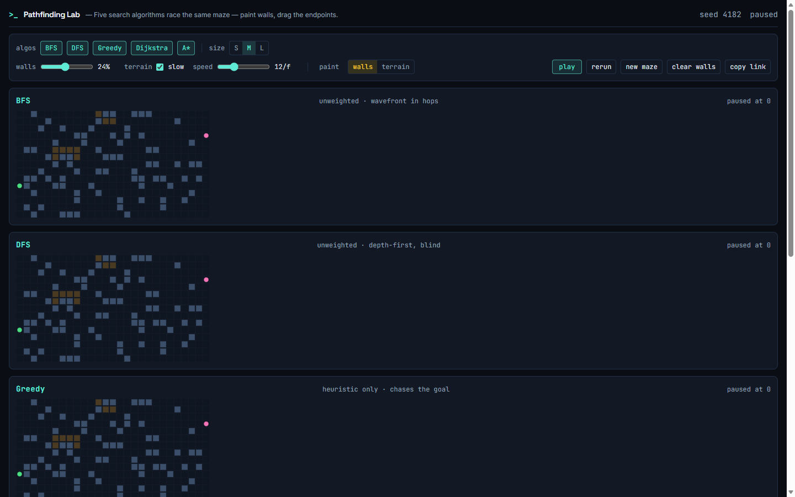

# Pathfinding Lab

Five search algorithms — BFS, DFS, Greedy Best-First, Dijkstra, and A\* —
racing across the **same** seeded maze, side by side, so you can *see*
what each one trades away. No accounts, no network, no engine.

- **Live:** `https://devdonner.github.io/pathfinding-lab/`
- **Source:** https://github.com/DevDonner/pathfinding-lab



## What it does

- **Same maze, fair race.** Every lane gets the identical grid (walls,
  slow terrain, start, goal) and advances in lockstep. The race auto-starts
  on load — that's the demo.
- **Progressive results.** Each lane prints its chip (visited · hops ·
  cost · OPTIMAL / suboptimal) the moment it finishes; the table below
  fills in lane by lane.
- **Honest labels.** BFS/DFS are unweighted (hops); Greedy chases the
  heuristic only; Dijkstra and A\* accumulate the weighted cost of the
  slow-terrain cells (weight 4). The optimality badge is judged against
  Dijkstra on the same grid.
- **You can break the maze.** Drag on any lane to paint walls (toggle) or
  slow terrain; drag the green ● / pink ● to move start/goal. Edits stop
  the run and every lane rebuilds from your maze. A walled-off goal is a
  legitimate state — every lane burns its component and prints `NO PATH`.
- **Shareable.** `?seed=N&size=s|m|l&wall=…&terrain=0|1&speed=…&algs=…`
  reproduces the exact race; a missing seed is minted and written back so
  every load is shareable.
- **Keyboard:** `Space` play/pause, `R` rerun, `N` new maze, `↑/↓` speed.

## Run it

```sh
npm install
npm run dev        # http://localhost:4182/pathfinding-lab/  (base matches Pages)
npm test           # node --test over the pure engine (43 tests)
npm run build      # tsc --noEmit && vite build
```

## Architecture

`DESIGN.md` is the design doc; this is the tour.

```
src/lab/
├── engine/          pure TS — no DOM, no React, no clock, unit-tested
│   ├── rng.ts        mulberry32 + randomSeed()
│   ├── grid.ts       Grid model, index math, fixed N-E-S-W neighbor order
│   ├── maze.ts       seeded generation + reachability guarantee
│   ├── algorithms.ts run(algo, grid) → Trace { steps, path, found }
│   ├── metrics.ts    visited / hops / cost / optimal flags
│   └── urlState.ts   ?seed&size&wall&terrain&speed&algs parse/build
├── ui/
│   ├── Lane.tsx        one canvas per algorithm, plays back its Trace
│   ├── Controls.tsx    algo/size/density/terrain/speed/paint + actions
│   └── ResultsTable.tsx rows light up as lanes finish
├── index.tsx        root: playback loop, editing, keyboard, URL, seam
├── meta.ts          LabMeta (portfolio contract)
└── types.ts         LabMeta type (self-contained copy)
```

**Playback model:** each `run(algo, grid)` precomputes the *entire*
expansion order and final path (pure function, no clock). The UI keeps one
global `progress` counter advanced by `requestAnimationFrame` at
`speed` steps/frame; every lane renders `steps[0..progress]` plus the path
revealed afterwards. The UI holds zero per-lane animation state.

**Determinism contract:** fixed neighbor order (N-E-S-W), mark-on-visit
(each cell expanded at most once), and stable heap tie-breaks (insertion
order). Same grid ⇒ identical trace, which is what the tests assert.

**Debug seam:** `window.__PATHLAB__ = { getState, setProgress, play,
pause, rerun, paint }` — deterministic playback and wall painting without
a pointer (used by the verification pass).

## Lifting into the portfolio

Copy `src/lab/` to `portfolio/src/labs/pathfinding-lab/` — zero changes
required (see `portfolio/LABS.md`). The lab uses only host theme tokens,
the default Tailwind palette, and arbitrary values; all maze colors are
drawn to canvas and never referenced from CSS, so nothing leaks into the
host theme. `meta.ts` may keep the local `types.ts` or switch to the
`@/labs/types` alias.

## Verification

See `REVIEW.md` for the gate scorecard. In short: `tsc --noEmit && vite
build` green, 43/43 `node --test` passing (including optimality proofs
against the Dijkstra/BFS references and crafted suboptimal witnesses for
DFS and Greedy), browser-verified at 1440 / 768 / 375 (see `screenshots/`),
keyboard + drag verified with real input events, zero runtime network,
shareable-URL round-trips, GitHub Pages deploy on push.
